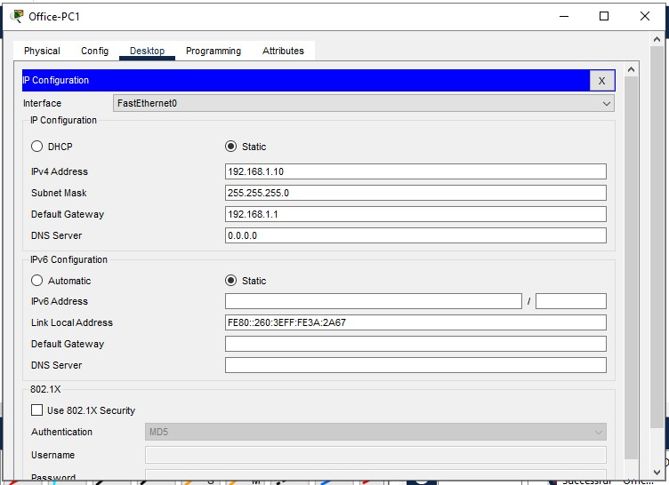
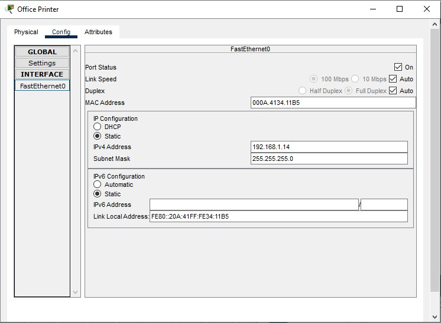
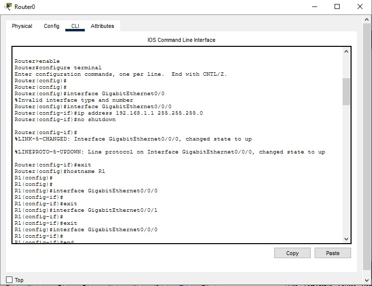
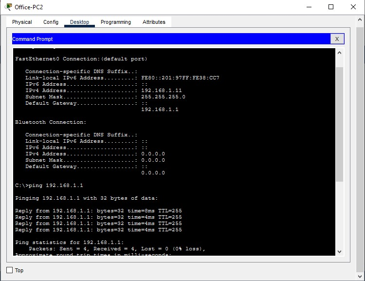
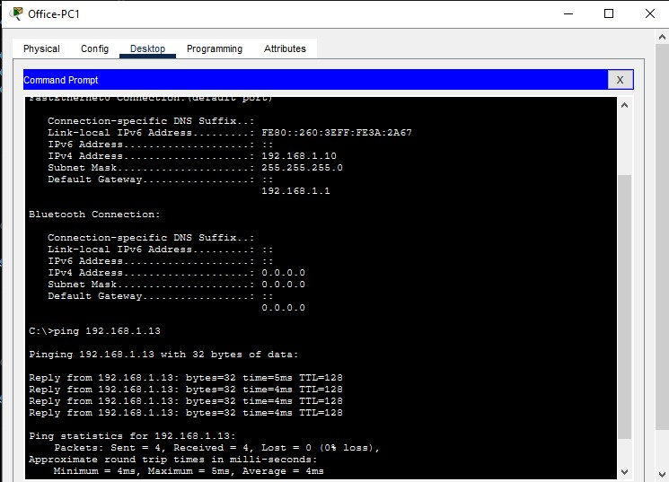
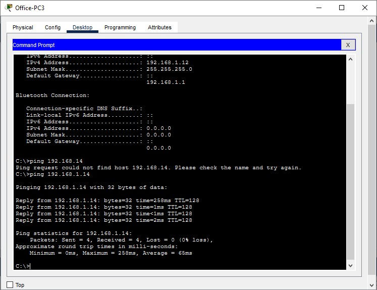

# Project 01: Small Office Network Design and Configuration

## 1. Project Overview

This project involved designing and configuring a basic Local Area Network (LAN) for a hypothetical small office environment using Cisco Packet Tracer.

The network was designed to connect four office workstations, a shared network printer, and a router through a central network switch. Static IPv4 addressing was used to configure the devices, while ICMP ping tests were performed to verify connectivity between the network devices.

The project demonstrates foundational networking skills, including network topology design, router interface configuration through the Cisco IOS CLI, IPv4 addressing, and basic network connectivity testing.

## 2. Problem Statement

Small office environments require reliable communication between workstations and shared network resources such as printers.

This project addresses the basic networking requirements of a small office by designing a LAN that allows multiple workstations to communicate with one another, access a network gateway, and reach a shared printer.

## 3. Project Objectives

The objectives of this project were to:

- Design a basic small-office LAN topology.
- Establish connectivity between multiple workstations and a network printer.
- Configure a router's LAN interface using the Cisco IOS CLI.
- Assign static IPv4 addresses and appropriate subnet masks to network devices.
- Configure the default gateway on end devices.
- Verify network connectivity using ICMP ping tests.
- Inspect and verify the operational status of the router interface.

## 4. Tools and Environment

| Component | Description |
|---|---|
| Network simulation software | Cisco Packet Tracer 9.0.1 |
| Router | Cisco ISR4331 |
| Switch | Cisco Catalyst 2960-24TT |
| End devices | Four PCs |
| Shared resource | Network printer |
| Connection type | Copper straight-through cables |
| Addressing method | Static IPv4 addressing |
| Network testing | ICMP ping |
| Router configuration | Cisco IOS CLI |

## 5. Network Design

### 5.1 Network Topology

The network uses a star topology, with a central switch connecting the four workstations, printer, and router.

The router provides the default gateway for devices within the LAN.

**Network topology diagram:**


*Figure 1: Small office LAN topology designed using Cisco Packet Tracer.*

### 5.2 IP Addressing Scheme

The network uses the `192.168.1.0/24` IPv4 network.

| Device | IPv4 Address | Subnet Mask | Default Gateway |
|---|---|---|---|
| Router LAN interface | 192.168.1.1 | 255.255.255.0 | N/A |
| Office-PC1 | 192.168.1.10 | 255.255.255.0 | 192.168.1.1 |
| Office-PC2 | 192.168.1.11 | 255.255.255.0 | 192.168.1.1 |
| Office-PC3 | 192.168.1.12 | 255.255.255.0 | 192.168.1.1 |
| Office-PC4 | 192.168.1.13 | 255.255.255.0 | 192.168.1.1 |
| Office Printer | 192.168.1.14 | 255.255.255.0 | 192.168.1.1 |

### 5.3 Network Diagram and Addressing Evidence



*Figure 2: Example of an end-device IPv4 configuration.*



*Figure 3: Network printer IPv4 configuration.*

## 6. Network Implementation

### 6.1 Topology Construction

The router, switch, four workstations, and network printer were placed in Cisco Packet Tracer.

The end devices and router were connected to the central switch using copper straight-through cables.

### 6.2 Router Interface Configuration

The router was configured manually through the Cisco IOS Command Line Interface (CLI).

The `GigabitEthernet0/0/0` interface was assigned the IPv4 address `192.168.1.1` with a subnet mask of `255.255.255.0`.

The interface was enabled using the `no shutdown` command.

The router's hostname was subsequently changed to `R1`.

The configuration included the following commands:

```cisco
enable
configure terminal
interface GigabitEthernet0/0/0
ip address 192.168.1.1 255.255.255.0
no shutdown
exit
hostname R1
end
```

During configuration, an initial attempt to access `GigabitEthernet0/0` returned an invalid interface error. This was resolved by selecting the correct interface, `GigabitEthernet0/0/0`.

### 6.3 Router Interface Verification

After configuration, the router interface was inspected using:

```cisco
show ip interface brief
```

The output confirmed that `GigabitEthernet0/0/0` had the manually assigned address `192.168.1.1`, with both its status and protocol showing `up`.

The remaining two Gigabit Ethernet interfaces were unassigned and administratively down. They were not required for this LAN configuration.



*Figure 4: Router interface status and IP address verification.*

### 6.4 End-Device Configuration

Static IPv4 addresses, subnet masks, and default gateways were assigned to the four workstations and network printer according to the addressing table.

## 7. Network Testing and Results

ICMP ping tests were performed to verify connectivity between the network devices.

The following categories of connectivity tests were conducted:

| Test | Destination | Purpose | Reported Result |
|---|---|---|---|
| PC-to-gateway | 192.168.1.1 | Verify connectivity to the router | Successful |
| PC-to-PC | Other workstation IP addresses | Verify communication between workstations | Successful |
| PC-to-printer | 192.168.1.14 | Verify IP-level reachability of the printer | Successful |

All three categories of tests were reported as successful.

### 7.1 PC-to-Gateway Connectivity



*Figure 5: ICMP connectivity test between a workstation and the router.*

### 7.2 PC-to-PC Connectivity


*Figure 6: ICMP connectivity test between workstations.*

### 7.3 PC-to-Printer Connectivity



*Figure 7: ICMP connectivity test between a workstation and the network printer.*

## 8. Challenges Encountered and Solutions

### Incorrect Router Interface Identification

During the router configuration process, the initial attempt to access `GigabitEthernet0/0` returned an invalid interface error.

**Solution:** The available interface naming was corrected by selecting `GigabitEthernet0/0/0`, after which the IPv4 configuration was completed successfully.

While pinging the printer, I made a mistake in the IPv4 address which resulted to an error. The error message: *Ping request could not find host 192.168.14. Please check the name and try again*

**Solution:** Corrected the IPv4 address to the exact IP of the printer

## 9. Lessons Learned

The project provided practical experience in:

- Constructing a basic LAN topology using Cisco Packet Tracer.
- Understanding the role of a switch in connecting devices within a LAN.
- Configuring a router interface through the Cisco IOS CLI.
- Assigning static IPv4 addresses and subnet masks.
- Understanding the function of a default gateway.
- Using ICMP ping to test network connectivity.
- Verifying router interface status using `show ip interface brief`.
- Identifying and correcting an incorrect interface selection.
- A single error in an IP address will result to an error (It's case sensitive.)

## 10. Project Limitations

This project focused on basic LAN design, static IPv4 configuration, and connectivity verification.

It did not implement or test:

- VLAN segmentation.
- DHCP address allocation.
- Network Address Translation (NAT).
- Access Control Lists (ACLs).
- Inter-VLAN routing.
- Advanced network monitoring.
- Enterprise-scale network security controls.

These areas are outside the current scope of the exercise and may be explored in subsequent practical projects.

## 11. Project Files and Evidence

| File | Description |
|---|---|
| `small-office-network.pkt` | Cisco Packet Tracer project file |
| `evidence/` | Screenshots documenting the topology, configuration, and tests |
| `README.md` | Project documentation |

## 12. Conclusion

The project successfully demonstrated the design and configuration of a basic small-office LAN using Cisco Packet Tracer.

The router's LAN interface was configured through the Cisco IOS CLI, static IPv4 addressing was applied to the network devices, and connectivity was tested between workstations, the gateway, and the network printer.

The exercise strengthened foundational knowledge of LAN design, IPv4 addressing, router interface configuration, and basic network troubleshooting.