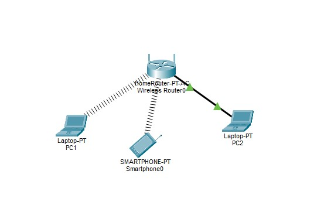

# Project 02: Physical LAN Deployment and Troubleshooting

## 1. Project Overview

This project involved setting up and testing a small physical Local Area Network (LAN) using two Windows laptops, a wireless router, and an Android smartphone.

The practical exercises focused on IP configuration, connectivity testing, Windows network folder sharing, and accessing an HTTP server hosted on an Android device.

The purpose was to gain practical experience with communication between wired and wireless devices on the same local network and to understand how network resources and services can be accessed by other devices.

## 2. Objectives

The objectives were to:

- Inspect and document the IP configuration of connected devices.
- Establish communication between wired and wireless devices.
- Use ICMP ping to test network connectivity.
- Share a folder between two Windows computers.
- Host a basic HTTP server on an Android device using Python.
- Access and retrieve a file from the Android-hosted server using another device.
- Document the results and observations.

## 3. Tools and Equipment

| Tool / Equipment | Purpose |
|---|---|
| Wireless router | Connected the devices to the LAN |
| Windows laptop 1 | Connected through Wi-Fi |
| Windows laptop 2 | Connected through Ethernet |
| Android smartphone | Hosted the HTTP server |
| Termux | Provided an Android terminal environment |
| Python HTTP server | Served files over the LAN |
| Windows Command Prompt | IP configuration and connectivity tests |
| Web browser | Accessed the Android HTTP server |
| Windows File Explorer | Accessed the shared network folder |

## 4. Network Topology and Addressing

The network consisted of two Windows laptops and an Android smartphone connected through a wireless router.

One laptop used a wireless connection, while the second laptop used a wired Ethernet connection. The Android smartphone connected through Wi-Fi.

### 4.1 Device IP Addressing

| Device | Connection | IPv4 Address | Subnet Mask | Default Gateway |
|---|---|---|---|---|
| Router | LAN gateway | 192.168.0.1 | Not recorded | — |
| Laptop 1 | Wi-Fi | 192.168.0.180 | 255.255.255.0 | 192.168.0.1 |
| Laptop 2 | Ethernet | 192.168.0.76 | 255.255.255.0 | 192.168.0.1 |
| Android phone | Wi-Fi | 192.168.0.222 | Not recorded | 192.168.0.1 |

The two Windows laptops had IP addresses within the same IPv4 subnet (192.168.0.0/24).

### 4.2 Network Diagram



## 5. Implementation and Practical Exercises

### 5.1 IP Configuration Inspection

The `ipconfig` command was used on both Windows laptops to inspect their network configurations.

The active interfaces showed:

- Laptop 1: Wi-Fi connection, IPv4 address 192.168.0.180.
- Laptop 2: Ethernet connection, IPv4 address 192.168.0.76.
- Both laptops used 192.168.0.1 as their default gateway.

The results were saved for documentation.

**Evidence:** `evidence/laptop1-wifi-ipconfig.txt` and `evidence/laptop2-ethernet.txt`.

### 5.2 Network Connectivity Testing

The `ping` command was used to test communication between devices.

The tests included:

- Laptop 2 to Laptop 1.
- Laptop 2 to the Android smartphone.
- Laptop 1 to other devices during the earlier connectivity exercises.

The recorded tests showed successful responses with zero packet loss.

| Test | Packets Sent | Packets Received | Packet Loss | Average RTT |
|---|---:|---:|---:|---:|
| Laptop 2 → Laptop 1 | 4 | 4 | 0% | 4 ms |
| Laptop 2 → Android phone | 4 | 4 | 0% | 58 ms |

These results confirmed IP connectivity between the tested devices.

**Evidence:** `evidence/laptop2-ethernet.txt`

### 5.3 Hosting an HTTP Server on Android

Termux was used to access the Android shared storage directory containing the test file.

The following commands were executed:

```bash
cd storage/shared
cd NetworkShare
python -m http.server 8000
```

Python started an HTTP server on port 8000.

The server hosted the contents of the `NetworkShare` directory, making its files accessible through a web browser on another device connected to the LAN.

**Evidence:** `evidence/android-server-terminal.jpg`.

### 5.4 Accessing the HTTP Server and Retrieving a File

The Ethernet-connected laptop accessed the Android server using:

```text
http://192.168.0.222:8000
```

The browser displayed the directory listing containing `test.txt`.

The file was subsequently accessed using:

```text
http://192.168.0.222:8000/test.txt
```

The browser successfully displayed the file content:

```text
Hello from my Android phone
```

The Termux server log recorded successful HTTP GET requests, including a `200` response for the file retrieval.

A separate request for `/favicon.ico` returned `404` because that file was not present in the hosted directory. This did not affect the successful retrieval of `test.txt`.

**Evidence:**
- `evidence/http-directory-listing.jpg`
- `evidence/http-file-retrieval.jpg`
- `evidence/android-server-terminal.jpg`

### 5.5 Windows Network Folder Sharing

A folder named `LAN-Share` was shared from one Windows computer and accessed from the other computer over the local network.

A test file named `network_test_PC2Wired.txt` was placed in the shared folder.

The Ethernet-connected laptop accessed the shared folder through Windows File Explorer. The test file was opened using Notepad, and its contents were displayed successfully.

This exercise demonstrated access to a shared Windows network resource from another computer on the LAN.

**Evidence:**
- `evidence/windows-shared-folder.jpg`
- `evidence/shared-file-opened.jpg`

## 6. Results

The practical exercises demonstrated the following:

1. Both Windows laptops obtained IPv4 configurations within the same local subnet.
2. Successful ICMP responses confirmed connectivity between the tested LAN devices.
3. An HTTP server was hosted on an Android smartphone using Python in Termux.
4. The Ethernet-connected laptop accessed the Android-hosted directory and successfully retrieved a text file.
5. A Windows shared folder was accessed from the other laptop, and a file within it was opened successfully.

The exercises provided practical exposure to local network communication, basic connectivity testing, and resource sharing.

## 7. Challenges and Observations

- The HTTP server recorded a `404` response for a browser request to `/favicon.ico`. This occurred because the requested icon was not available in the hosted directory.
- The Android ping tests showed varying response times. Further testing would be required to investigate the variation.
- The HTTP server had to remain running in Termux while the other device accessed its files.

## 8. Skills Practised

- IPv4 configuration inspection.
- Basic subnet identification.
- Wired and wireless LAN connectivity.
- ICMP connectivity testing.
- Windows network folder sharing.
- Basic client-server communication.
- Hosting an HTTP service using Python.
- Accessing network resources through a browser.
- Reading and interpreting basic network command output.

## 9. Limitations and Future Improvements

This was a small home-LAN practical rather than an enterprise network deployment.

The exercises did not include VLAN configuration, advanced router configuration, enterprise DHCP management, firewall policy implementation, or formal network performance monitoring.

Possible improvements include:

- Capturing and analysing network traffic using Wireshark.
- Investigating DNS resolution and other network services.
- Performing additional controlled connectivity troubleshooting.
- Documenting network resource access permissions more extensively.

## 10. Conclusion

This project provided practical experience in connecting and testing devices on a small physical LAN. It also demonstrated how network resources can be shared between Windows computers and how an Android device can host a simple HTTP service accessible to other devices on the same network.

The exercises strengthened my understanding of IP addressing, connectivity testing, local resource sharing, and basic client-server communication.